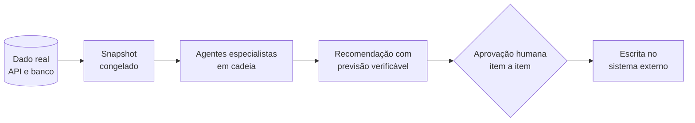

  

  

  
  
  

---

## 👋 Sobre mim

Engenheiro de Computação e Analista de Sistemas na **GBPA**, consultoria de IA. Trabalho com **IA aplicada ao atendimento e à automação de processos** em empresas: entender como a operação funciona hoje, desenhar a solução e colocar no ar agentes de IA, integrações e automações que resolvem o problema de ponta a ponta. Desde 2022 atuo com atendimento digital, primeiro integrando sistemas e automatizando fluxos, hoje construindo agentes de IA conversacionais para clientes corporativos.

- 🤖 **Agentes de IA conversacionais** de voz e texto, com respostas ancoradas na base de conhecimento e guardrails de LLM
- 🔌 **Integração de sistemas e automação de processos**: APIs REST, plataformas de integração, contact center e helpdesk
- 🧪 **Qualidade de IA antes do go-live**: testes de regressão, simulação com personas, avaliação por AI Judge e métricas de conversa
- 📐 **Do problema à proposta**: levantamento de requisitos, desenho de solução, estimativa técnica e UAT
- 🧠 **Desenvolvimento assistido por IA**, com vários agentes em cadeia e gates de revisão, segurança e aprovação humana
- 🛒 Fora do trabalho, mantenho um **sistema de gestão de e-commerce** integrado à API do Mercado Livre e uma **fábrica de software** de sites e demos
- 🎓 Bacharel em Engenharia da Computação (UNISAL, 2025), com certificações em IA conversacional, integração e agentes de IA
- 🗣️ Português nativo · inglês intermediário

---

## 🚀 Projetos em destaque

### 🛒 Sistema de gestão de e-commerce com IA
Projeto próprio · jul/2026 – atual · repositório privado

Sincroniza vendas, frete, Ads, faturamento e estoque pela API do Mercado Livre (OAuth com renovação automática de token) e calcula margem, DRE e caixa. Substituiu uma planilha e uma ferramenta paga, com rotina diária automática, alertas e relatório HTML.

| Medida | Resultado |
|---|---|
| ⚡ Consulta de pedidos, com sincronização incremental pela data de alteração | de 985 pedidos em 9 s para **20 pedidos em 1,5 s** |
| ⚡ Etapa de faturamento | de ~111 s para **26 s** |
| ✅ Tabela oficial de frete, contra dados reconciliados | validada em **98,3%** (176 de 179 pedidos) |
| ✅ Receita | conferida **ao centavo** por duas fontes independentes da API |

**Nove agentes especialistas** analisam o negócio em cadeia sobre um snapshot congelado dos dados, com varredura completa dos itens, handoff estruturado e previsão verificável. Os agentes só analisam e recomendam: **toda escrita na API (preço, Ads, mensagens) exige aprovação humana, item a item.**

### 🏭 Fábrica de software com agentes de IA
set/2026 – atual · sites e demos para clientes

- **Agendamento de aulas para academia (PWA):** agendamento e cancelamento com regra de lotação, cota por plano, reposição e fila de espera, relatórios, exportação CSV/JSON e uso offline com dados em IndexedDB. Construído com agentes de IA em cerca de 4 h do meu trabalho.
- **Demo 3D navegável de uma sala comercial (Three.js):** maquete com visita por pontos, troca de uso do ambiente e botão que abre o WhatsApp com o pedido pronto. Arquivo único de 245 KB, conferido em tela de 360 px.
- Cada entrega passa por uma **esteira de 11 agentes especializados**, com gates de qualificação, escopo, desenho, segurança e QA.

### 🎙️ Agente de IA de voz no Cognigy.AI
GBPA · demo de atendimento por voz para uma grande locadora de veículos

- AI Agent com persona própria, respostas restritas à Knowledge e guardrails contra transferência e encerramento indevidos
- Ferramentas de transferência ao PABX e de encerramento da chamada
- Analytics da conversa com Goals e Tasks (resposta, transferência e encerramento)
- Plano de regressão no Simulator com personas, missões e AI Judge, cobrindo guardrails e perguntas fora do escopo

<b>📂 Repositórios públicos</b> (projetos da faculdade e estudos)

 

| Projeto | O que é | Stack |
|---|---|---|
| [**circula-bem**](https://github.com/pedrovictoriano/circula-bem) | App para uma comunidade emprestar e alugar gratuitamente os próprios pertences: grupos, cadastro de itens, calendário de reserva e gestão de aluguéis | React Native · Expo · Supabase |
| [**medication-tracking**](https://github.com/pedrovictoriano/medication-tracking) | Controle de estoque e circulação de medicamentos em hospitais: lotes, fabricantes, localizações, movimentações e notificações | Node.js · Express · MySQL · EJS |
| [**labirinto-3D**](https://github.com/pedrovictoriano/labirinto-3D) | Exploração de um labirinto 3D comparando os algoritmos de backtracking e guloso, com animação do caminho | Python · NumPy · Matplotlib |
| [**projetos-python**](https://github.com/pedrovictoriano/projetos-python) | Coleção de scripts e estudos em Python | Python |
| [**projetos-html-css-js**](https://github.com/pedrovictoriano/projetos-html-css-js) | Componentes de interface: cronômetro, página 404, formulários de login e cadastro, navbar responsiva | HTML · CSS · JavaScript |
| [**portfolio**](https://github.com/pedrovictoriano/portfolio) | Portfólio pessoal responsivo, sem framework | HTML · CSS · JavaScript |

---

## 🧭 Como eu trabalho com agentes de IA

Agente de IA analisa e recomenda. Quem decide o que sai para o mundo é uma pessoa.

- **Dado congelado antes da análise.** Todos os agentes leem a mesma foto do dado, então duas análises da mesma rodada nunca discordam porque leram momentos diferentes.
- **Previsão verificável.** Recomendação diz o que espera que aconteça e quando dá para conferir. "Vai melhorar" não conta.
- **Conferir contra a fonte.** Número que importa é validado contra dado real, de preferência por duas fontes independentes.
- **Gates explícitos.** Escopo, desenho, segurança e QA são etapas com dono, não boas intenções.
- **Medir antes de reagir.** Antes de adicionar uma métrica (como sentimento em voz), entender o que ela mede, onde falha e quanto custa em latência.

---

## 🛠️ Stack

**IA e agentes**

**Automação e integração**

-0f172a?style=for-the-badge)

**Linguagens, dados e front-end**

  

**Método**

---

## 💼 Trajetória

| Período | Cargo | Empresa | Destaques |
|---|---|---|---|
| mar/2026 – atual | Analista de Sistemas I | **GBPA** | Agentes de IA de voz no Cognigy.AI, avaliação com AI Judge, cinco propostas técnicas para um BPO de atendimento (autoatendimento, governança, plataforma unificada, automação bancária com RPA e motor de regras, monitoramento de portais), kit de componentes reutilizáveis entre projetos |
| abr/2022 – fev/2026 | Analista de Sistemas I | **Aegea Saneamento** | Automação e atendimento digital com APIs REST, Genesys Cloud, Cognigy, Azure Logic Apps e Zendesk; fluxos ponta a ponta de integração, roteamento e notificação; otimização de desempenho; requisitos e UAT antes do go-live |
| ago/2021 – mar/2022 | Estagiário de Suporte Técnico | **MicroWork Softwares** | Suporte a usuários de várias áreas, priorização por SLA e melhorias no fluxo de suporte |

---

## 🎓 Formação e certificações

**Bacharelado em Engenharia da Computação** · Centro Universitário Salesiano de São Paulo (UNISAL) · 2021 – 2025

| Certificação | Emissor | Data |
|---|---|---|
| NiCE Certified AI Engineer, Cognigy Associate (NCAE) | NiCE Cognigy | set/2026 |
| Cognigy Certified Specialist | Cognigy | mar/2026 |
| [Agents and Workflows](https://oaiacademy.credential.net/a93ae9ef-1dca-4d9e-9d05-21b9a1417061?key=7102017f23a3d57f977a2fa20a0b1d87d99e2ce136f4c25b5c2bf01390688746) | OpenAI Academy | set/2026 |
| [Claude 101](https://academy.claude.com/verify/2f4a25e8b2757355ec89b747501c9258) | Claude Academy (Anthropic) | set/2026 |
| [Claude Code 101](https://academy.claude.com/verify/df89dce80e1acef838aa4d7d7007f1df) | Claude Academy (Anthropic) | set/2026 |
| Workato Foundations, níveis 1 e 2 | Workato | 2026 |
| Infobip: Product Portfolio, Answers, Conversations, Moments e People | Infobip | mar/2026 |
| Intensivo MultiCloud, DevOps & IA | The Cloud Bootcamp | 2024 |

Os certificados com link têm verificação pública.

---

## 📫 Contato

  
  

  

